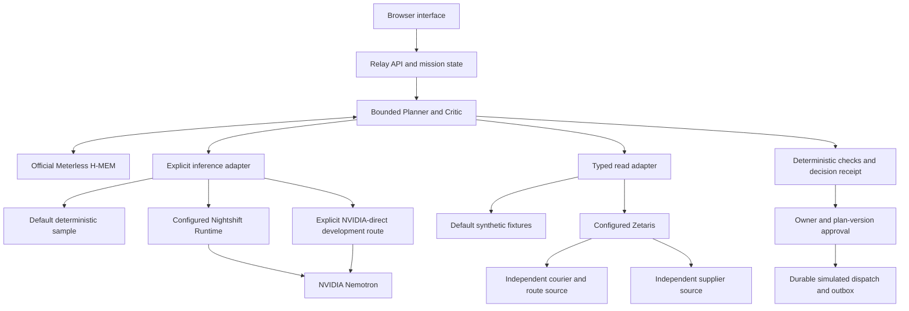

# Standalone Relay architecture

Baseline default: real H-MEM and application state, deterministic sample model/data, simulated operations. The live model and Zetaris paths require separately provisioned services and remain unverified. The private ROVER application is not included or required. A future private implementation may use the public DispatchPort contract.
