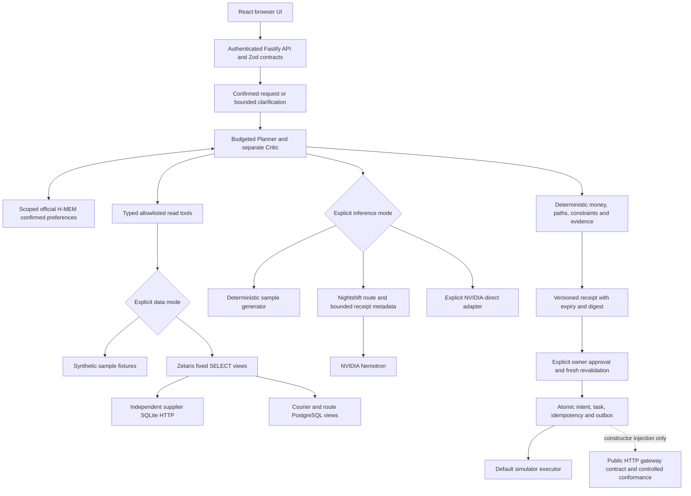

# Current Relay architecture

Current event candidate, RELAY-12. The immutable [baseline](BASELINE.md) describes the older implementation.

The agent chooses bounded evidence-gathering actions rather than arbitrary SQL or URLs. Missing request facts produce clarification. Planner proposals and separate Critic reviews use proposal-2.0 contracts with at most one targeted repair inside the shared budget. Hard arithmetic, capacity, deadlines, evidence coverage and approval authority remain deterministic. See [intake](INTAKE_AND_COORDINATION.md) and [review](PLANNER_CRITIC_REVIEW.md).

Data, inference and execution modes are independent. Offline sample uses synthetic data, a deterministic substitute and the real H-MEM engine. Live data uses Zetaris federation with synthetic campus operational records. Nightshift is an explicitly selected route with Runtime-correlated Nemotron evidence. NVIDIA-direct remains a separate explicit option. Errors never trigger a silent sponsor or sample fallback. Health/configuration alone cannot prove a full mission.

H-MEM stores explicitly confirmed entrance preferences under hashed tenant/user/venue scope. Both roles receive the retrieved records/context. Correction, forgetting and process restart preserve scope and invalidate stale approval terms. Audit retention differs from active-memory forgetting. Stock, route and courier availability are refreshed operational observations, never permanent memory. One writer owns each data directory. [Memory safety](MEMORY_SAFETY.md).

SQLite is the default CPU sample store. PostgreSQL serializes aggregate mutations with row locks; callback retries do not repeat execution effects. Approval binds stored owner, plan version/digest, source/memory revisions, expiry and idempotency. A changed source, decline or changed preference produces a new plan requiring approval. Outbox deduplication and lifecycle compare-and-set checks prevent duplicate task effects. This is a reference single-tenant deployment, not production identity/multi-tenancy. [PostgreSQL safety](POSTGRES_SAFETY.md).

RELAY-10 provides execution-1.0 JSON Schema/OpenAPI and an injectable `ExecutionAdapter`. The normal server uses `SimulatorExecutor`. The generic HTTP gateway is exercised only by controlled fixtures and has no production activation flag. A future private ROVER service must enforce real identity, selected provider, acceptance and payments. No private schema/source or real booking ships here. [Execution contract](EXECUTION_CONTRACT.md).

RELAY-11 recorded 21 public gates passing, 114 application tests and 14 PostgreSQL checks. A normal API mission through Nightshift and real Zetaris took 39,917 ms with two model POSTs, two Zetaris queries, discovery and receipt-log read. These six Relay HTTP attempts exclude Runtime internal fanout. Planner reported Nemotron Super VL and Critic Nemotron Ultra. Exact Lightning pinning and independent NVIDIA attestation remain unverified. [Evaluation](EVALUATION.md).

The browser serves current plan/history, structured decision summaries and source-specific provenance. It does not display private model reasoning, service tokens or provider keys. Live Relay requires its own bearer token; the browser never needs the Nightshift token. Loopback sample mode is intentionally local. [Browser behavior](BROWSER_EXPERIENCE.md).
